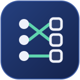

<p align="center">
  
</p>

<h1 align="center">AllotMate</h1>

<p align="center"><b>Fair Elective Allocation Engine.</b><br>Students propose. Gale–Shapley decides. Every run is audited.</p>

<p align="center">
  <!-- Build and project -->
  <a href="https://github.com/AnubhavKiroula/AllotMate/actions/workflows/ci.yml"></a>
  <a href="LICENSE"></a>
  <a href="docs/06_VERSION-CONTROL.md"></a>
</p>

<p align="center">
  <!-- Stack -->
  <a href="CMakeLists.txt"></a>
  <a href="CMakeLists.txt"></a>
  <a href="docs/DB-SETUP.md"></a>
  <a href="include/PostgresConnection.h"></a>
  <a href="docker-compose.yml"></a>
  <a href="tests"></a>
</p>

<p align="center">
  <!-- Project -->
  <a href="src/MatchingEngine.cpp"></a>
  <a href="docs/PERFORMANCE.md"></a>
  <a href="docs/00_PROJECT-OVERVIEW-AND-DIAGRAMS.md"></a>
</p>

> **Provably Fair Student-Elective Matching System**
> Combined Data Structures (C/C++) + Object-Oriented Programming (C++) Academic Project (PBL) with real institutional applicability for 1,500+ students.

---

## 📌 Problem & Solution Overview

- **The Problem:** Every semester, 1,500+ students rank elective courses against strict seat limits. Existing manual or First-Come-First-Serve (FCFS) allocations reward speed or luck, are vulnerable to human bias, and offer **no stability guarantee** (students and electives may form blocking pairs who both prefer to swap).
- **The Solution:** **AllotMate** adapts the **Gale–Shapley stable matching algorithm** (student-proposing variant) with seat capacities, custom data structures (Sparse Matrix, Priority Queue, AVL Trees, Threaded BST, Hash Tables), and an RAII-compliant PostgreSQL persistence layer via `libpqxx`.

---

## ⚡ Key Highlights & Core Features

1. **Provable Fairness via Gale–Shapley Matching:** Guaranteed stable matching with zero blocking pairs. Includes an automated mathematical fairness checker after every run.
2. **Custom Syllabus Data Structures:** Custom implementations of `SparseMatrix`, `HashTable`, `PriorityQueue`, `AVLTree`, `ThreadedBST`, and `Stack` rather than generic standard library shortcuts.
3. **Strict SOLID & DRY OOP Design:** Abstract base class `Person` with derived `Student` & `Coordinator`, repository pattern (`Repository<T>`), RAII resource wrappers, and custom exception hierarchy.
4. **PostgreSQL Relational Persistence:** Direct SQL via `libpqxx` (no heavy ORM overhead), custom connection pooling, B-tree/composite indexes, and containerized Docker setup.
5. **Bulk CSV Ingestion at Scale:** Validated data ingestion supporting 1,500+ records with duplicate roll-number detection.
6. **Automated CI/CD Quality Gate:** GitHub Actions workflow ensuring `-Wall -Wextra -Werror` zero-warning compilation on all branches.

---

## 🛠️ Technology Stack

| Layer | Technology | Role & Purpose |
|---|---|---|
| **Core Language** | C++17 | Algorithmic matching, domain entities, and data structures |
| **Database** | PostgreSQL 16 | Relational persistence, constraints, and composite indexes |
| **Database Connector** | `libpqxx` (C++ client) | Native, low-overhead SQL execution without ORM |
| **Containerization** | Docker & Docker Compose | Containerized database environment across all machines |
| **Build System** | CMake 3.16+ | Multi-platform build and compiler warning gates |
| **CI / Quality Gate** | GitHub Actions | Automated build verification on `main` and `dev` |
| **DB Inspection GUI** | pgAdmin 4 | Visual table inspection and query evaluation |

---

## 🏛️ Module Ownership & Syllabus Mapping

| Module | Member / Role | Core DS Concepts (DS Syllabus) | Core OOP Concepts (OOP Syllabus) | Evaluator Track |
|---|---|---|---|---|
| **Persistence & DB Layer** | **Member 1 — Anubhav Kiroula** (Team Lead · Backend & DB) | Sorting (bulk import), Indexing structures | RAII, Repository Pattern (`Repository<T>`), Connection Pool | **Joint Evaluator** |
| **Domain Models & Trees** | **Member 2 — Kritika Mundepi** (OOP Architect) | AVL Tree, Threaded BST, Hashing | Inheritance, Polymorphism, Operator Overloading | **OOP Evaluator** |
| **Integration, CLI & Testing** | **Member 3 — Gaurang Nauriyal** (Integration & CLI) | — | Single Responsibility (CLI only does I/O), integration & load testing | **Panel Review** |
| **Matching Engine** | **Member 4 — Dhruv Negi** (DS / Algorithm Lead) | Priority Queue, Stack (backtracking), Sparse Matrix | Strategy pattern, Custom exceptions | **DS Evaluator** |

---

## 🗄️ Database Schema & Relational Design

The system persistence is backed by PostgreSQL 16 across 7 relational entities (DDL in [`sql/01_init_schema.sql`](sql/01_init_schema.sql)):

1. **`STUDENT`**: Stores student profiles, unique roll numbers, branches, and CGPA with constraints.
2. **`ELECTIVE`**: Defines course names, semester, seat capacities, and filled seat counts.
3. **`PREFERENCE`**: Ranked student choices with `UNIQUE(student_id, elective_id)` & `UNIQUE(student_id, rank)` to prevent duplicate preference submissions.
4. **`ALLOTMENT`**: Final allocation records per student and round with `UNIQUE(student_id, round)`.
5. **`WAITLIST`**: Ranked waitlist positions per elective backed by `UNIQUE(elective_id, position)`.
6. **`COORDINATOR`**: Academic coordinator profiles with department and bcrypt-hashed credentials.
7. **`RUN_LOG`**: Immutable audit logs of every Gale-Shapley matching run, tracking timestamps, coordinator ID, blocking pairs detected, and outcome summaries.

### Performance Indexing Strategy
- **B-tree Index on `STUDENT(roll_no)`**: O(log N) fast lookup during individual student queries and duplicate check.
- **Composite Index on `PREFERENCE(student_id, rank)`**: Instant O(1)/O(log N) retrieval of student preference order during Gale-Shapley proposal rounds.
- **Index on `ALLOTMENT(elective_id)`**: Rapid capacity enforcement and elective seat lookups at 1,500-student scale.

---

## 🚀 Quickstart & Setup Guide

> 💡 **For Evaluation Demo (September 5th):**  
> Run these 3 simple commands in order in your terminal:
> ```bash
> # 1. Start PostgreSQL 16 DB (seeds 100 students & 6 electives)
> docker compose up -d
> 
> # 2. Build C++ Engine
> cmake -B build -S . && cmake --build build
> 
> # 3. Launch Interactive CLI
> ./build/AllotMate            # On Linux / WSL
> .\build\Debug\AllotMate.exe  # On Windows
> ```

### 1. Prerequisites
- **Docker Desktop** (running)
- **C++17 Compiler** (GCC 9+, Clang 10+, or MSVC 2019+)
- **CMake 3.16+**
- **pgAdmin 4** (optional, for visual inspection)

### 2. Environment Configuration
Copy the template configuration file:
```bash
cp .env.example .env
```
The template already holds the defaults for the local Docker database (port `5433`, so it does not clash with a locally installed PostgreSQL on `5432`). Change them only if your database differs. `.env` is git-ignored — never commit it.

### 3. Start PostgreSQL Database
```bash
docker compose up -d
```
*Automatically brings up PostgreSQL 16 on port `5433`, runs `sql/01_init_schema.sql`, and seeds 100 students and electives from `sql/02_seed_data.sql`.*

### 4. Build and Run the Interactive CLI
```bash
# Configure build with CMake
cmake -B build -S .

# Compile executable
cmake --build build --config Release

# Launch the AllotMate interactive CLI
./build/AllotMate            # On Linux / macOS / WSL
.\build\Debug\AllotMate.exe  # On Windows
```
The program will launch an interactive terminal menu. Choose `[1] Coordinator` to access the full admin menu, or `[2] Student` for status lookup. Press `[0]` from the coordinator menu to enter **Evaluator Mode** for live OOP and DS concept demonstrations.

### 5. Inspect Data via CLI / pgAdmin
- **Direct Terminal SQL:**
  ```bash
  docker exec -it allotmate_postgres psql -U postgres -d allotmate
  ```
- **pgAdmin GUI:** Register Server with Host `localhost`, Port `5433`, Database `allotmate`, and the user/password from your `.env`.

---

## 👥 Team & Contributions

> **Hand-written data structures:** `vector`, `string`, streams, smart pointers, `map` and `set` are used where allowed (OOP Unit 5). Everything from the DS syllabus is our own code: no `std::sort`, `<stack>`, `<queue>`, `std::priority_queue` or `std::list` in project logic, trees built from our own nodes, and our own `HashTable` instead of `unordered_map`/`unordered_set`.

### Member 1 — Anubhav Kiroula (Team Lead · Backend & DB)
PostgreSQL schema, RAII connection, repositories, CSV bulk import (merge sort), `AllocationService` (one transaction, advisory-lock `RunLock`, `RUN_LOG` audit), waitlists saved with every run and shown to students (FR-7, FR-2), 1,500-scale profiling ([`docs/PERFORMANCE.md`](docs/PERFORMANCE.md)).

### Member 2 — Kritika Mundepi (OOP Architect)
`Person` hierarchy and polymorphism, exception hierarchy, `AVLTree` and `ThreadedBST` from our own nodes with Rule of 5, the AVL waitlist in `Elective`, `MeritRankingReport`, model unit tests.

### Member 3 — Gaurang Nauriyal (Integration & CLI)
CLI screens Run Allocation (with the fairness report), View Results, View Waitlist and Import CSV, plus the 1,500 × 30 load test ([`docs/LOAD-TEST.md`](docs/LOAD-TEST.md)).

### Member 4 — Dhruv Negi (DS / Algorithm Lead)
`SparseMatrix`, `HashTable` (rehash at load factor 0.7), `Stack`, `PriorityQueue`, the Gale–Shapley loop, `detectBlockingPairs()`, `FairnessReport` and the FCFS vs Gale–Shapley benchmark (FCFS 1,336 blocking pairs vs 0 on 1,500 students).

---

## 📂 Project Directory Structure

```text
AllotMate/
├── .github/
│   └── workflows/
│       └── ci.yml               # Automated CI build gate (-Wall -Wextra -Werror)
├── docs/                        # Complete PBL specification & design documents
│   ├── 00_PROJECT-OVERVIEW-AND-DIAGRAMS.md
│   ├── 01_PRD.md
│   ├── 02_SRS.md
│   ├── 03_ARCHITECTURE.md
│   ├── 04_UIUX.md
│   ├── 05_DEVELOPMENT.md
│   ├── 06_VERSION-CONTROL.md
│   ├── DB-SETUP.md              # Database & pgAdmin setup guide
│   ├── LOAD-TEST.md             # 1,500 x 30 load test through the CLI
│   └── PERFORMANCE.md           # Measured 1,500-scale benchmarks & EXPLAIN plans
├── include/                     # C++ header files & interfaces
│   ├── AVLTree.h                # Custom AVL tree (waitlist priority order)
│   ├── AllocationException.h    # Custom domain & database exception hierarchy
│   ├── AllocationService.h      # End-to-end run: lock, match, save, audit
│   ├── CLI.h                    # Interactive terminal interface
│   ├── ConnectionPool.h         # RAII pool of reusable DB connections
│   ├── Coordinator.h            # Academic coordinator domain model
│   ├── CsvImporter.h            # CSV parse + validation + merge sort + de-dup
│   ├── Elective.h               # Elective course domain model
│   ├── HashTable.h              # Custom open-addressing hash table
│   ├── MatchingEngine.h         # Gale-Shapley engine, blocking pairs, FairnessReport
│   ├── MeritRankingReport.h     # CGPA merit ranking via threaded in-order walk
│   ├── Person.h                 # Abstract base class
│   ├── PostgresConnection.h     # RAII PostgreSQL client wrapper
│   ├── PostgresElectiveRepo.h   # Repository<Elective> implementation
│   ├── PostgresStudentRepo.h    # Repository<Student> + bulk insert
│   ├── PriorityQueue.h          # Custom binary max-heap
│   ├── ReportRepository.h       # Result / unmatched / waitlist report queries
│   ├── Repository.h             # Generic Repository<T> template interface
│   ├── RunLogRepository.h       # RUN_LOG audit read/write
│   ├── SparseMatrix.h           # Triplet sparse preference matrix
│   ├── Stack.h                  # Custom stack
│   ├── Student.h                # Student domain model
│   ├── StudentRecord.h          # Plain CSV row (persistence-free)
│   ├── ThreadedBST.h            # Custom right-threaded BST (stack-less in-order)
│   └── WaitlistRepository.h     # Atomic waitlist persistence
├── sql/                         # Auto-run by Docker on first start
│   ├── 01_init_schema.sql       # 7-table DDL, constraints & indexes
│   └── 02_seed_data.sql         # 100-student realistic seed script
├── scripts/                     # Run by hand (NOT auto-run)
│   ├── benchmark_seed.sql       # N-student dataset for the FCFS benchmark (-v student_count=N)
│   ├── explain_core_queries.sql # EXPLAIN ANALYZE index profiling
│   ├── migrate_phase3.sql       # Upgrade existing DBs (nullable blocking pairs)
│   └── scale_seed_1500.sql      # 1,500 students x 30 electives dataset
├── src/                         # C++ implementation source files
│   ├── AllocationService.cpp
│   ├── CLI.cpp
│   ├── ConnectionPool.cpp
│   ├── Coordinator.cpp
│   ├── CsvImporter.cpp
│   ├── Elective.cpp
│   ├── MatchingEngine.cpp
│   ├── MatchingEngineTest.cpp   # Engine unit tests (Member 4)
│   ├── PostgresConnection.cpp
│   ├── PostgresElectiveRepo.cpp
│   ├── PostgresStudentRepo.cpp
│   ├── ReportRepository.cpp
│   ├── RunLogRepository.cpp
│   ├── SparseMatrix.cpp
│   ├── Student.cpp
│   ├── WaitlistRepository.cpp
│   └── main.cpp                 # Application entrypoint
├── tests/                       # CTest unit & integration tests
│   ├── CMakeLists.txt
│   ├── *_demo.cpp               # 7 DS demos (AVL, threaded BST, waitlist, merit ranking); built by CI
│   ├── test_allocation.cpp      # End-to-end: capacity, stability, waitlists, locking
│   ├── test_csv_importer.cpp    # Pure-logic: CSV validation, merge sort, capacity
│   ├── test_db_layer.cpp        # Repository/DB integration (skips w/o DB)
│   └── test_models.cpp          # Student/Elective edge cases, AVL & threaded BST
├── tools/
│   ├── benchmark_db.cpp         # 1,500-scale DB timings
│   └── benchmark_matching.cpp   # FCFS vs Gale-Shapley: blocking pairs, first choice, time
├── data/                        # Sample datasets
│   └── students_sample.csv      # Example bulk-import file
├── .env.example                 # Environment configuration template
├── .gitignore                   # Git ignore rules
├── CLAUDE.md                    # Team coding conventions (incl. STL rule)
├── CMakeLists.txt               # CMake build configuration
├── CONTEXT.md                   # Living project state
├── docker-compose.yml           # PostgreSQL 16 container definition
├── LICENSE                      # MIT License
└── README.md                    # Project overview
```

---

## 📄 License
This project is licensed under the [MIT License](LICENSE) — built for academic Data Structures & Object-Oriented Programming PBL evaluation.
