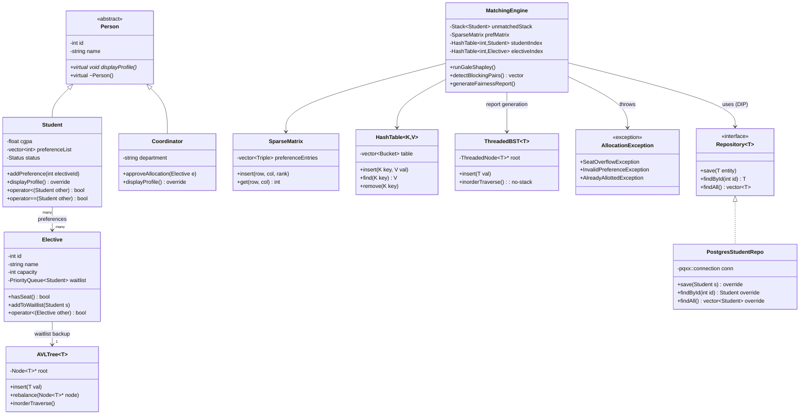
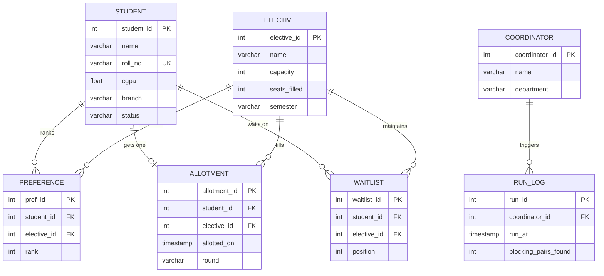

# AllotMate — Fair Elective & Lab-Batch Allocation Engine
### PBL Design Document (Data Structures in C + OOP in C++)

---

## 1. Overview

**Problem:** 1500 students rank electives/lab batches by preference; seats are limited. Manual/FCFS allocation is unfair and unauditable.

**Solution:** A Gale–Shapley stable-matching engine (student-proposing) with capacity-aware colleges, backed by PostgreSQL, exposed via a thin service layer, written in modular C++ using classic data structures for every subsystem instead of generic STL shortcuts where the syllabus demands a real implementation.

**Tech stack**
- **Language:** C++17 (custom DS classes wrapping/replacing STL where required for evaluation)
- **DB:** PostgreSQL via `libpqxx`
- **Build:** CMake + Makefile
- **Interface:** CLI admin tool first → optional lightweight web dashboard (Phase 4, stretch)
- **Version control:** Git, feature-branch workflow, 1 branch per module owner

---

## 2. Module → Owner → Syllabus Mapping

| Module | Owner | Core DS used | Core OOP used |
|---|---|---|---|
| Matching Engine | Member 1 | Priority Queue, Stack (backtracking), Sparse Matrix | Strategy pattern, exceptions |
| Domain Models | Member 2 | — | Inheritance, polymorphism, operator overloading |
| Waitlist & Reporting | Member 1/2 | AVL Tree, Threaded BST, Hashing | Templates, iterators |
| Persistence Layer | Member 3 | Sorting (bulk import) | RAII, Repository pattern |
| Integration/Testing/Docs | Member 4 | — | Unit tests, benchmarks |

---

## 3. UML Class Diagram



**SOLID touchpoints already baked in:**
- **S**: `MatchingEngine` only matches; `Repository` only persists; `Student`/`Elective` only hold state.
- **O**: New allocation strategies (e.g. merit-weighted) extend via a `Strategy` interface, no engine edits.
- **L**: `Student`/`Coordinator` are substitutable wherever `Person*` is expected.
- **I**: Separate `Repository<Student>` vs `Repository<Elective>`, no fat interfaces.
- **D**: `MatchingEngine` depends on `Repository` abstraction, not `PostgresStudentRepo` directly — swap DB layer without touching logic.

---

## 4. ER Diagram (PostgreSQL)



**Indexing plan:** B-tree index on `student.roll_no`, composite index on `preference(student_id, rank)`, index on `allotment(elective_id)` for capacity checks at scale.

---

## 5. Phased Roadmap

| Phase | Deliverable | Weeks |
|---|---|---|
| **1. Design** | This doc finalized, Git repo + branch structure, CMake skeleton compiling empty modules | 1 |
| **2. Boilerplate** | `Person`/`Student`/`Coordinator`/`Elective` classes, empty `MatchingEngine`, DB schema created + migrations, dummy data seeded (100 → 1500 records) | 2 |
| **3. Modular build** | Each owner implements their DS class independently against agreed interfaces; unit tests per module | 3–5 |
| **4. Integration** | Wire `MatchingEngine` to `Repository`, run Gale-Shapley end-to-end on seeded data, fix mismatches | 6 |
| **5. Scale test + fairness report** | Load-test at 1500 students, benchmark runtime, blocking-pair detection report | 7 |
| **6. Polish + docs + viva prep** | CLI/dashboard, README, architecture writeup, rehearse both evaluator narratives | 8 |

---

## 6. Why This Project Is Competitive Across the Whole 2nd Year (Not Just DS/OOP)

Most peer projects will be CRUD apps with a database, or shallow "we used ML" pitches with no algorithmic depth. AllotMate differs on three axes:

1. **Provable correctness** — Gale-Shapley guarantees a *stable* matching (no blocking pairs). You can mathematically demonstrate this in the demo, not just claim it works.
2. **Real institutional utility** — this solves an actual problem the college has every semester, not a toy scenario.
3. **Full-stack engineering discipline** — SOLID, clean module boundaries, DB-backed persistence at real scale (1500 students), and a genuinely separated microservice for the ML add-on.

**Positioning line for judges:** *"Most teams show you code that runs. We're showing you an allocation system that is mathematically proven fair, and can be handed to the exam/academic cell tomorrow."*

---

## 7. ML Add-On Module (Optional, Isolated Microservice)

**Principle:** ML never touches the C++ core. It's a separate Python service called over REST, so it can be demoed as a bonus without risking the core deliverable's stability or diluting the DS/OOP evaluation.

### 7.1 What it does — two small, honestly-justifiable features

**A. Elective Demand Forecasting**
- **Input:** historical preference data (past 2–3 semesters) — which electives students ranked #1/#2, grouped by branch/CGPA band.
- **Model:** simple regression or a small classifier (scikit-learn — Linear Regression or Random Forest is enough; no deep learning needed).
- **Output:** predicted demand count per elective for the upcoming semester.
- **Why it matters to the story:** coordinators can set `capacity` in the `ELECTIVE` table *before* running Gale-Shapley, instead of guessing — directly improves the fairness/efficiency of the matching stage.

**B. Preference-Collusion Flagging**
- **Input:** the full preference matrix for the current run.
- **Model:** simple clustering (k-means or cosine similarity on preference-rank vectors) to flag groups of students with suspiciously near-identical ranking patterns (possible proxy-filling/friend-grouping).
- **Output:** a list of flagged student clusters for the coordinator to manually review — never auto-rejects anyone.
- **Why it matters to the story:** ties directly back to your core pitch of *fairness* — you're not just matching efficiently, you're actively protecting the process's integrity.

### 7.2 API contract (Flask/FastAPI, single service)

```
POST /forecast/demand
  body: { "elective_id": int, "historical_ranks": [ {semester, rank_counts} ] }
  returns: { "elective_id": int, "predicted_demand": int, "confidence": float }

POST /forecast/collusion-check
  body: { "preference_matrix": [ [student_id, elective_id, rank], ... ] }
  returns: { "flagged_clusters": [ [student_id, ...], ... ], "notes": string }
```

- C++ core calls these via `libcurl` (or simply — for the demo — a Python script invoked as a pre-processing CLI step reading/writing CSV, if REST integration is too much overhead this late).
- Output feeds back into Postgres (`elective.capacity` update, or a new `flagged_review` table) — the C++ engine never has to know ML happened; it just reads updated data.

### 7.3 Scope discipline
- Build this **last**, only after the C++ core runs end-to-end and is demo-stable.
- If time runs short, this is the first thing to cut — say so confidently in the pitch ("designed and spec'd, implementation status: in progress") rather than faking it.
- Never mix this code into the graded C++ repo structure — keep it in a clearly separate `/ml-service` folder so both evaluators see an unambiguous, undiluted view of their own subject's work.

---

## 8. Team Roles (Updated, incl. ML)

| Member | Role | Owns |
|---|---|---|
| **1 — DS/Algorithm Lead** | Matching engine: sparse matrix, hashing, priority queue, stack backtracking, threaded BST reporting | Presents to **DS evaluator** |
| **2 — OOP Architect** | Class hierarchy, inheritance, operator overloading, exceptions, STL, SOLID structure | Presents to **OOP evaluator** |
| **3 — Backend/DB Engineer** | Postgres schema, libpqxx integration, bulk import at 1500-record scale, indexing | Supports both |
| **4 — Integration, Testing, Docs & ML** | End-to-end testing, benchmarking, demo build, documentation, and (stretch) the isolated ML microservice | Ties the whole story together for the panel |

*(If you're 5–6 members: split Member 4 into Testing+Docs and a dedicated ML/Dashboard owner.)*

---

## 9. The Pitch (For Tomorrow's Approval)

**Duration target: ~3 minutes talk + have this doc ready if they want detail.**

> **Opening (hook — 15 sec)**
> "Every semester, 1500 students rank electives, and seats are limited — right now that's resolved manually or first-come-first-serve, which we can show is provably unfair. We're building a system that fixes that, permanently, for this college."

> **The core idea (30 sec)**
> "We're implementing Gale-Shapley stable matching — the same algorithmic idea behind national medical residency allocation — adapted for student-elective allocation with seat capacity. It doesn't just assign fast, it guarantees mathematically that there's no pair of a student and elective who'd both prefer to swap out of their current assignment. That's not a claim, it's provable, and we'll show the proof in our demo."

> **Why it's the right project for THIS syllabus (30 sec)**
> "It's a genuine combined DS + OOP project, not two projects stitched together. Every core data structure from our DS-in-C syllabus has a real job here: sparse matrices for the preference data, priority queues and stack-based backtracking for the matching itself, AVL trees and threaded binary trees for waitlists and reporting, hashing for instant lookups at 1500-student scale. And the entire system is architected in C++ following SOLID principles — inheritance and polymorphism for student/coordinator roles, operator overloading for comparisons, custom exception handling, and a clean repository pattern over a real PostgreSQL backend."

> **Scale & realism (20 sec)**
> "We're not demoing this on 20 fake students — we're building and load-testing it at real scale, 1500 records, so we can actually hand this to the exam or academic cell as a working tool, not just a submission."

> **The stretch/innovation layer, since we're AI/ML (30 sec)**
> "Since we're an AI/ML batch, we're adding an isolated forecasting layer as a bonus: a small ML service that predicts elective demand from historical preference data, so coordinators can set realistic seat capacities before matching runs, plus a lightweight check that flags suspicious near-identical preference patterns for review. This stays fully separate from the core engine by design, so it never puts the core deliverable at risk — it's a genuine add-on, not padding."

> **Close / ask (15 sec)**
> "This is real, usable, provably fair, and scoped so every team member has clear, independent ownership. We'd like approval to start this week."

**If asked "why is this hard / novel":** *"Stable matching isn't in our syllabus at all — we chose it because FCFS and manual allocation are provably unfair, and we wanted to solve the actual problem, not just check syllabus boxes."*

**If asked "what if the ML part doesn't get finished":** *"It's fully spec'd and isolated by design — the core system is complete and functional with or without it, so there's zero risk to the main deliverable."*

**If asked "why C++ when DS is taught in C":** *"Our OOP syllabus is in C++, and since this is a joint evaluation, we implemented every data structure natively in C++ ourselves rather than leaning on STL shortcuts, so both subjects are genuinely represented in the same codebase."*

---

## 10. Next artifacts to build (in order)
1. Repo structure + CMakeLists.txt skeleton
2. Header-only interface definitions (`Person.h`, `Repository.h`, `AllocationException.h`) so all 4 members can code in parallel without blocking each other
3. Postgres schema `.sql` migration file
4. `/ml-service` folder scaffold (Flask/FastAPI stub matching the API contract above) — built last

Say the word and I'll generate the actual boilerplate repo structure next.
