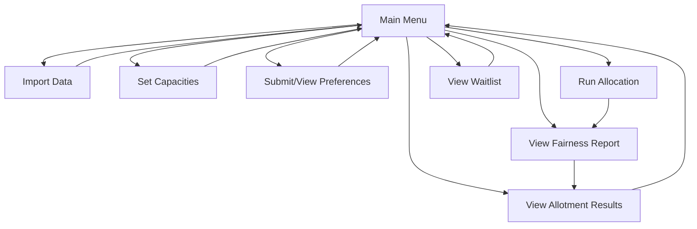

# UI/UX Document — AllotMate

> **For AI coding tools:** The CLI is the core, required interface — it must be built first and must be fully functional on its own. Everything in Section 3 (optional dashboard) is stretch scope and must never block or delay CLI completion.

---

## 1. Interface Philosophy

This is primarily a **backend/algorithm-focused academic project**. The interface exists to demonstrate the system working correctly and clearly during evaluation and demo — not to be a polished consumer product. Priority order:

1. **CLI (required)** — functional, clear, demo-ready.
2. **Web dashboard (optional/stretch)** — only attempted after CLI + core engine are fully stable.

## 2. CLI — Screens/Flows (Core, Required)

Since there's no GUI, "screens" here means **distinct CLI menu states**. Each should be a clear, numbered prompt.

### 2.1 Main Menu
As implemented in `src/CLI.cpp`:
```
Login as:
  [1] Coordinator (full admin access)
  [2] Student     (view own allotment status)

=== Coordinator Menu ===
[1] View Electives & Seat Availability
[2] Update Elective Seat Capacity
[3] View All Students
[4] View Student Preferences
[5] Run Allocation (Gale-Shapley)      -> ends with the fairness report
[6] View Allotment Results
[7] View Waitlist
[8] Import Students from CSV
[0] OOP & DS Concepts Demo (Evaluator Mode)
[9] Exit

=== Student Menu ===
[1] View My Allotment Status           -> allotment + waitlist positions
[2] Exit
```

### 2.2 Flow Diagram



**Rationale for the flow:** Running allocation (E) automatically leads into the fairness report (F) — this is deliberate, since the fairness proof (see project design doc, Section on proving Gale-Shapley) should never be a separate, skippable step. It's shown immediately as part of the result, reinforcing the core pitch every time the system runs.

### 2.3 Coordinator vs Student view

For the CLI, keep it simple: a single tool with a role prompt at startup —
```
Login as: [1] Coordinator  [2] Student (roll number lookup only)
```
Coordinator gets the full menu above; Student gets a reduced menu (view own status only — maps to FR-2 in the SRS).

## 3. Optional Web Dashboard (Stretch Goal — Only If Time Permits)

**Do not start this until:**
- Core C++ engine runs end-to-end correctly on seeded data, AND
- Fairness verification is working and demoed successfully via CLI.

**If time permits, minimal scope only:**

| Screen | Purpose |
|---|---|
| Login | Coordinator auth (see Architecture doc, Section 4) |
| Dashboard | Summary: total students, electives, last run status, blocking pairs = 0 badge |
| Capacities | Table to set/edit elective seat counts |
| Run Allocation | Single button, triggers backend run, shows loading + result |
| Results | Table of final allotments, filter by elective/branch |
| Waitlist | Per-elective waitlist view |

**Flow:** Login → Dashboard → (Capacities → Run Allocation) → Results/Waitlist.

**Tech approach if attempted:** simple server-rendered pages or a lightweight SPA hitting the internal REST layer mentioned in the Architecture doc — no need for a heavy frontend framework given the scope and timeline. Keep it visually clean but simple (a clear table + one big "Run Allocation" button demos better than a complex UI under time pressure).

## 4. Explicit Non-Goals for UI

- No mobile app.
- No real-time collaborative editing.
- No complex data visualization beyond simple tables/counts — the fairness *proof* is the visual centerpiece, not charts.
